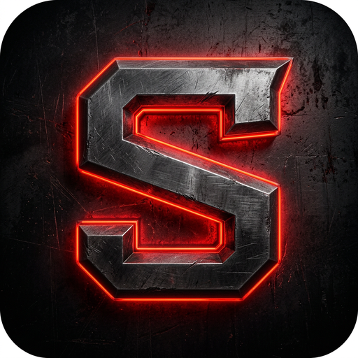

# Shandy — FiveM Roleplay Server Launcher + Discord Bot

> The complete, self-hosted desktop client for your **GTA V RP (FiveM)** server:
> one-click connect, live server status, Discord-powered announcements,
> player verification and automatic updates — distributed as ready-to-install
> apps for **Windows, macOS and Linux**.



**Buy it · [License terms](#licensing--terms) · [What's included](#package-contents) · [FAQ](#faq)**

---

## Why Shandy?

Players join RP servers through a fivem:// link and hope for the best.
Shandy turns that into a real product experience for your community:

- a branded app players install once and always connect to the right server
- live player count, map, mode and latency before they even click *Connect*
- announcements written once in Discord land in the app automatically
- whitelist verification through Discord — no hand-maintained lists
- crash reports straight to you instead of silent rage-quits

Everything is **self-hosted and yours**: your GitHub Releases, your Discord
bot, your data. Nothing is proxied through third-party services.

---

## What you get

- **Launcher** (Electron, ~1 500 LOC): full source, build config, icons
- **Discord bot**: announcements with scheduling, `/status`, unread feed, webhook bridge
- **CI/CD**: GitHub Actions — tests on every push, tagged releases build all three platforms and publish them automatically
- **Documentation**: setup guides, security analysis, engineering changelog
- **License to modify, rebrand and sell installs to your players** (see below)

## Feature checklist

### Launcher

- ✅ One-click **Connect** — opens `fivem://` for the right server (multi-server supported, config only)
- ✅ **Live status** — players/max, occupancy bar, map, mode, latency (polling in main process, never from the page)
- ✅ **Auto-update** — checks your GitHub Releases on start, downloads in-app with progress, one-click restart & install
- ✅ **Announcements feed** — from your bot (`announcementUrl`) or bundled JSON; in-app reader with unread badge
- ✅ **Discord Rich Presence** — "Playing Shandy RP · 43/64 online" (optional)
- ✅ **FiveM process detection** — shows when the player is already in FiveM (Windows)
- ✅ **Tray mode** — minimize to tray instead of closing, stays with FiveM while playing
- ✅ **Crash diagnostics** — local crash reports (max 5), one-click "copy to Discord ticket" / "report on GitHub"; nothing ever leaves the machine automatically
- ✅ **Whitelist via Discord** — implicit OAuth2 flow, token never stored; role/membership check done by your bot
- ✅ **Crash-free & CSP-strict** — `contextIsolation`, `sandbox`, no Node in the page, `default-src 'self'`
- ✅ **Interface language** — Serbian and English, one setting

### Bot

- ✅ `/najava` — post announcements to `#announcements` **and** the launcher feed in one command; supports **scheduled posts** (`vreme:18:30` or `YYYY-MM-DD HH:MM`)
- ✅ Tags: `NAJAVA` (announce), `EVENT`, `IZMENA` (change), `INFO` — mapped to colors automatically
- ✅ `/obavestenja`, `/obrisi-najavu` — list & delete posts
- ✅ `/status` — live server status read from the server's `dynamic.json`
- ✅ **FiveM webhook bridge** — `POST /webhook/fivem` with a Bearer secret lets server scripts auto-post *restart* / *start* / *maintenance* announcements (strict templates, no injection, 10 s gap)
- ✅ **Whitelist verify endpoint** — `POST /whitelist/verify` validates the player's Discord token server-side, checks guild membership or a configured role; rate-limited; tokens are never logged or stored
- ✅ Runs **without any privileged intents** (no message content access)

### Engineering

- ✅ 49 automated static checks (smoke-test) — CSP, IPC parity, syntax, file map
- ✅ IPC harness — all 25 IPC handlers exercised on a stubbed Electron
- ✅ Discord bot tests — 25 checks incl. verifier stubs & HTTP behaviour (no Discord account required)
- ✅ GitHub Actions: CI on push/PR + release pipeline for Windows/macOS/Linux on `v*` tags
- ✅ Dependabot weekly, `npm audit` reporting

## Screenshots & assets

All artwork ships in the package (`build/icon.*`, `src/renderer/assets/`).
The launcher UI is a polished dark RP theme with a live hero section,
server info modal, settings modal, crash diagnostics and a full-width
announcements ticker.

## System requirements

**To run the launcher:** Windows 10+, macOS 11+, or 64-bit Linux (AppImage); GTA V + FiveM for actual play.

**To build & operate it yourself:**

- Node.js 20+ and npm
- A GitHub repository you control (updates ship through GitHub Releases)
- A Discord application + bot (free) for announcements, whitelist and webhook
- A FiveM server artifact exposing `dynamic.json` / `info.json`
- Optional: code-signing certificates for Windows/macOS (buyer's responsibility — CI is ready, see `docs/UNAPREDJENJA.md`)

## Package contents

```
src/                  launcher source (main process, preload, renderer, config)
bot/                  Discord bot (slash commands, webhook, whitelist verify)
scripts/              preview server, smoke tests, IPC harness, e2e, e2e harness
.github/workflows/    ci.yml (checks) + build.yml (3-platform release on tags)
build/                icons (icon.png / .ico / .icns + master artwork)
docs/                 this file, setup analysis, engineering changelog
config.example.json   documented example configuration
LICENSE               ISC (see note below)
```

## Getting started (buyer)

1. Create a **private** GitHub repository and push this code to it.
2. `cp config.example.json config.json` — set your server's host/port, links,
   optional `announcementUrl`, `servers[]`, Discord `clientId`, `whitelistApiUrl`.
3. Discord Developer Portal → your application:
   - add bot (`Bot` section) → token into `bot/.env`
   - OAuth2 redirects += `shandy://whitelist`
   - `bot/.env`: `DISCORD_TOKEN`, `DISCORD_CLIENT_ID`, `DISCORD_GUILD_ID`,
     `ANNOUNCEMENTS_CHANNEL_ID` (optionally `WHITELIST_ROLE_ID`, `WEBHOOK_SECRET`)
4. `cd bot && npm install && npm test` → `/najava test` in Discord, then
   `curl http://<bot-host>:8734/news.json`
5. Point `announcementUrl` in the launcher config at that endpoint.
6. `npm install && npm start` to try the app, then `git tag v2.2.0 && git push origin v2.2.0` —
   GitHub Actions builds installers for all three platforms and drafts the Release.

Detailed, step-by-step guides: [README.md](../README.md) and [bot/README.md](../bot/README.md).

## Licensing & terms

**Draft commercial license — edit to taste before publishing:**

- One purchase = full source code + rights to modify and rebrand for **your own community/server(s)**.
- You may distribute built binaries to your players (that is the point of a launcher).
- You may **not** redistribute or resell the source code, or offer it as a competing product.
- No attribution required; keep the copyright notice intact in source form.
- **Updates:** all releases for 12 months from purchase [or: lifetime while maintained].
- **Support:** best-effort help with setup over [ Discord / e-mail ] for 30 days.

The bundled `LICENSE` file is ISC with the author's copyright for the v2 codebase's
open history; distribution under the commercial terms above supersedes it for buyers.
*(Seller: if you intend closed-source distribution only, replace LICENSE with a plain
proprietary notice before publishing — consult your lawyer.)*

## Pricing

**[ PRICE TBD — set by seller. Suggested range: US$199–499 one-time ]**

Includes 12 months of updates and 30 days of setup support.
Optional: hosted builds + auto-update endpoint for +[ fee ]/year.

## FAQ

**Can I rebrand it with my server's name/logo?**
Yes — that is the intended use. Replace `build/icon.*` and the assets; everything else follows the config.

**Do players need a Discord account?**
No. Rich Presence and whitelist are optional. The launcher works standalone.

**Do I need to keep the bot running 24/7?**
For scheduled announcements, webhook auto-posts and whitelist verification — yes.
For the bundled-info launcher alone, no.

**What if my server changes IP?**
Edit `config.json` (and/or `servers[]`), ship a new patch release. The in-app updater carries it to players.

**Is my data safe?**
The launcher stores only `settings.json` and local crash logs. Discord tokens are never persisted. The bot stores announcements in a JSON file you control.

**Will I get the source?**
Yes — this purchase ships the full source.

---

© Shandy Roleplay. All rights reserved unless licensed otherwise.
Engineering notes behind the project: [ANALIZA.md](ANALIZA.md) · [UNAPREDJENJA.md](UNAPREDJENJA.md) (internal, Serbian).
